# Too far away - Writeup

**Category:** OSINT / Misc
**Points:** 912

> The flag is right there, on the sign :)
>
> (you do need a minecraft account to solve)

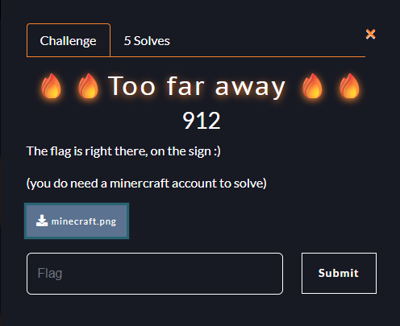

We get a screenshot from Hypixel SkyBlock with a sign circled in red. The sign is way too far away to read, so we have to go there ourselves.

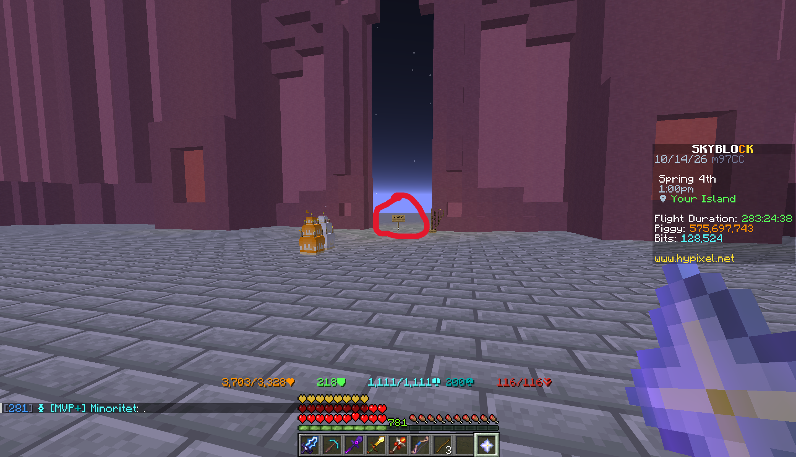

## Getting into the game

First head to [minecraft.net/download](https://www.minecraft.net/en-us/download).
Either buy Minecraft, or download the launcher if you already own it.

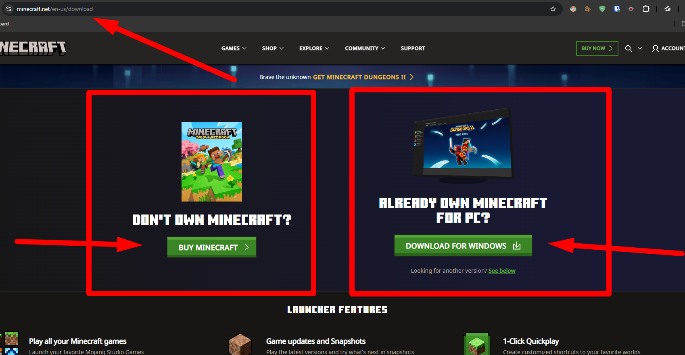

Once the launcher is installed and you're logged in, click **Play**.

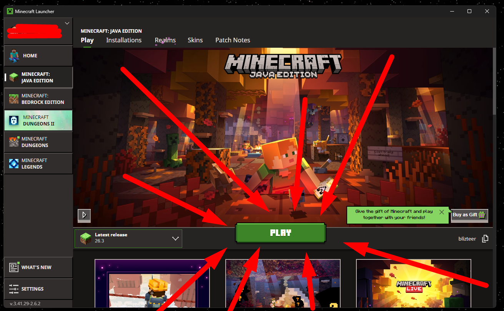

Press **Continue**.

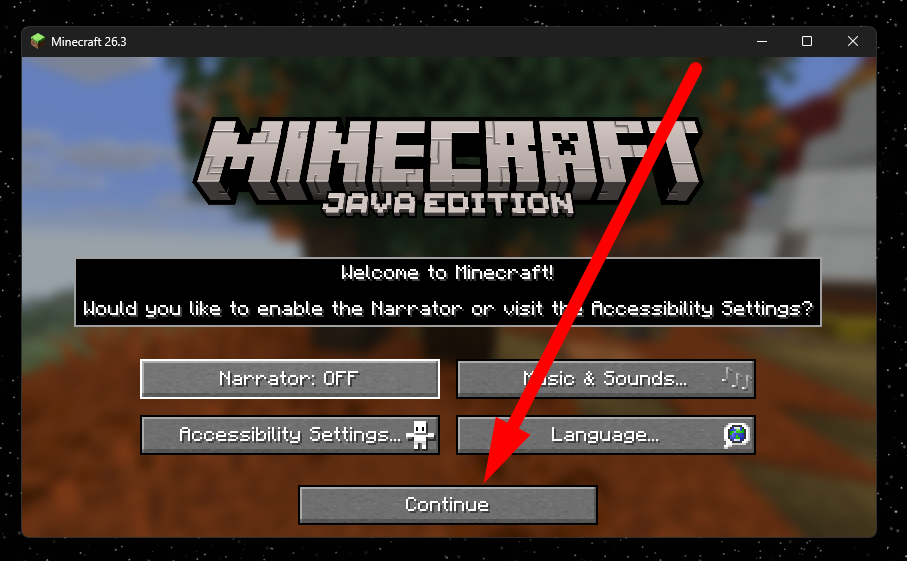

Then click **Multiplayer**, and accept third-party online play.

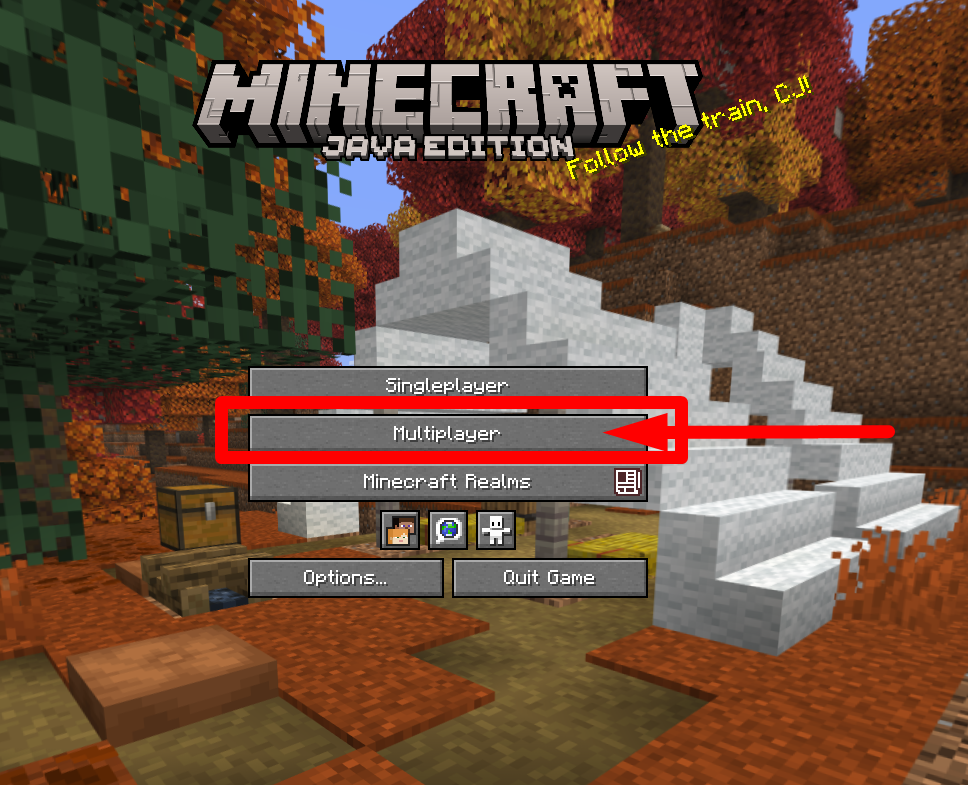

## Finding the server

In the screenshot we can see the scoreboard says `www.hypixel.net`, and it's SkyBlock. So the player is on Hypixel SkyBlock.

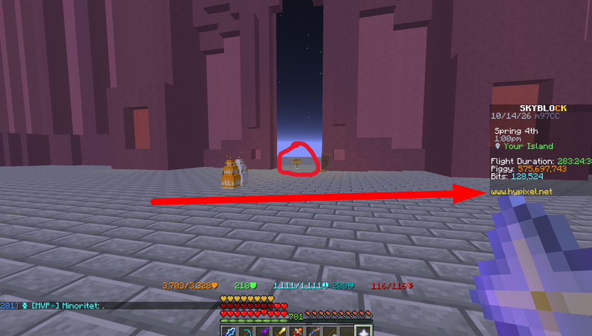

Add a new server with the IP `mc.hypixel.net`.

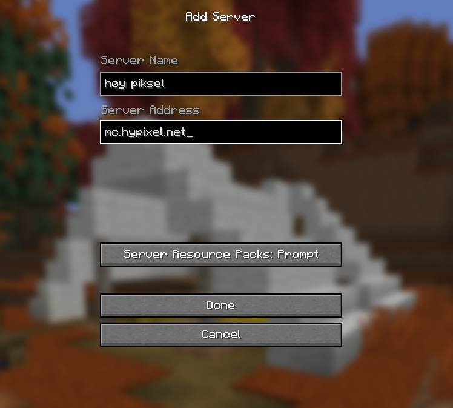

When you're in the server, open the Game Menu in your hotbar and click on **SkyBlock**.

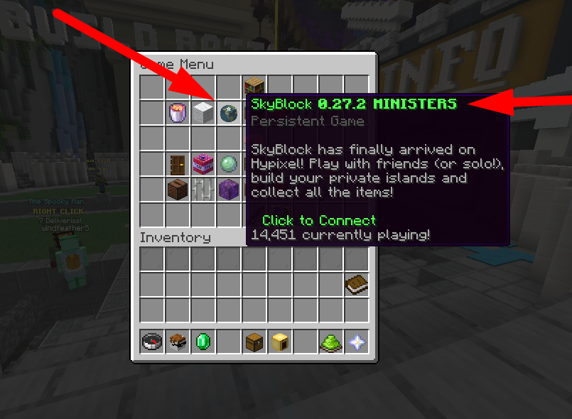

Click **Proceed** on the resource pack prompt.

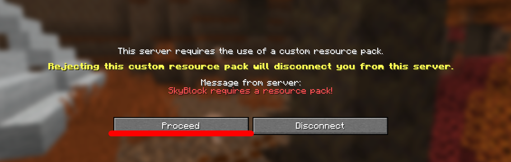

## Visiting his island

Now you're on your own island. We need to get to his island instead. In the bottom left of the screenshot you can see a chat message from him, so his username is **Minoritet**.

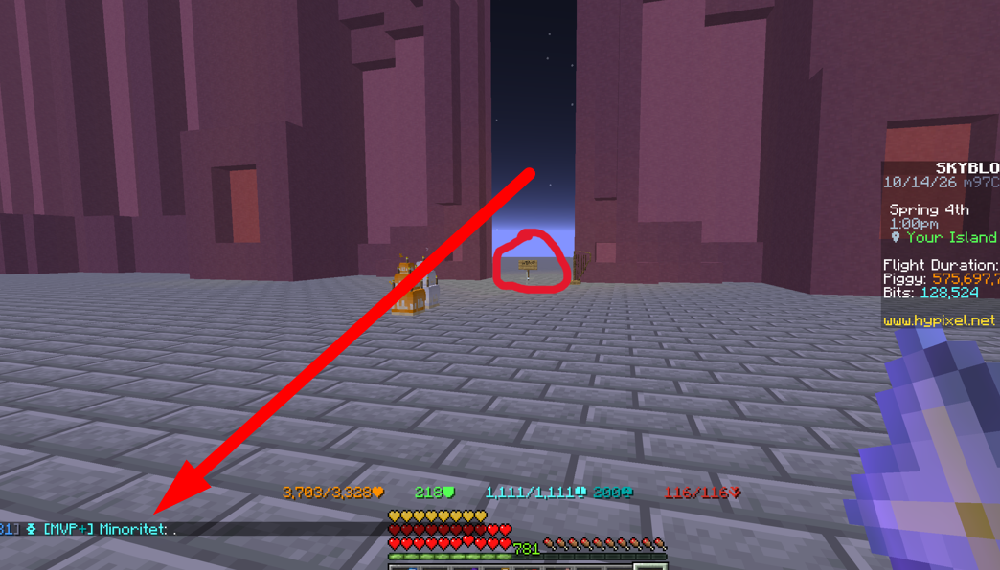

Type this in the chat:

```
/visit Minoritet
```

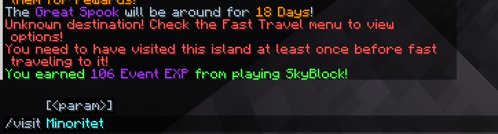

Click to visit his island.

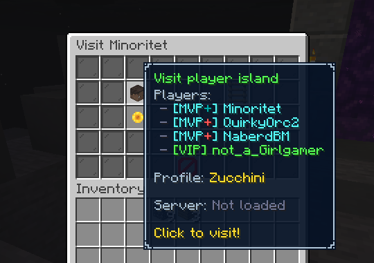

## The sign

Here we are. The sign is right there, just walk around it to the front.

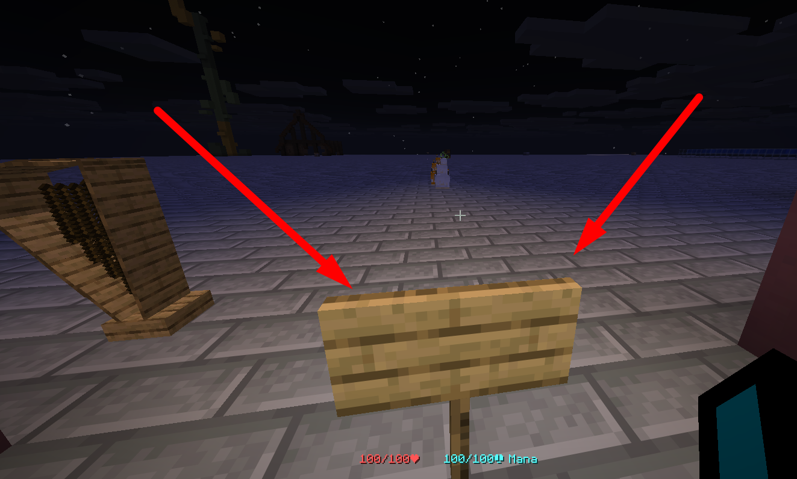

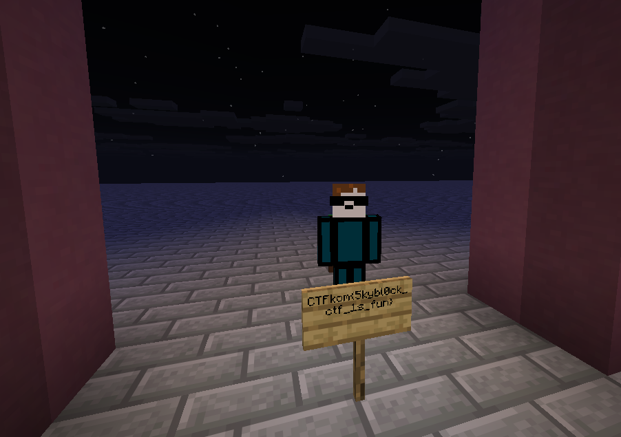

## Flag

```
CTFkom{5kybl0ck_ctf_1s_fun}
```

## Bonus

Amazing world btw. Had to take a look around before leaving :)

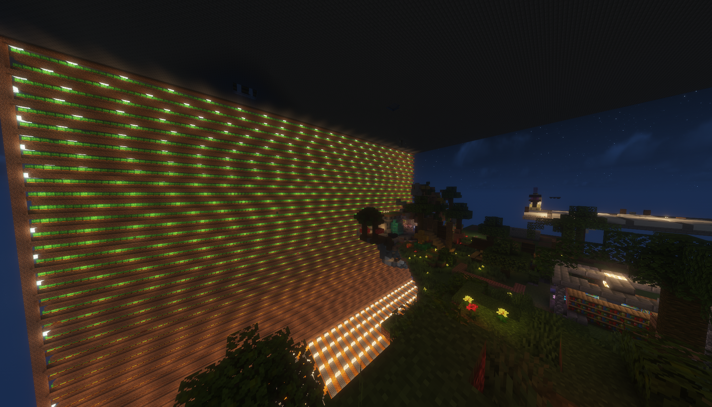
